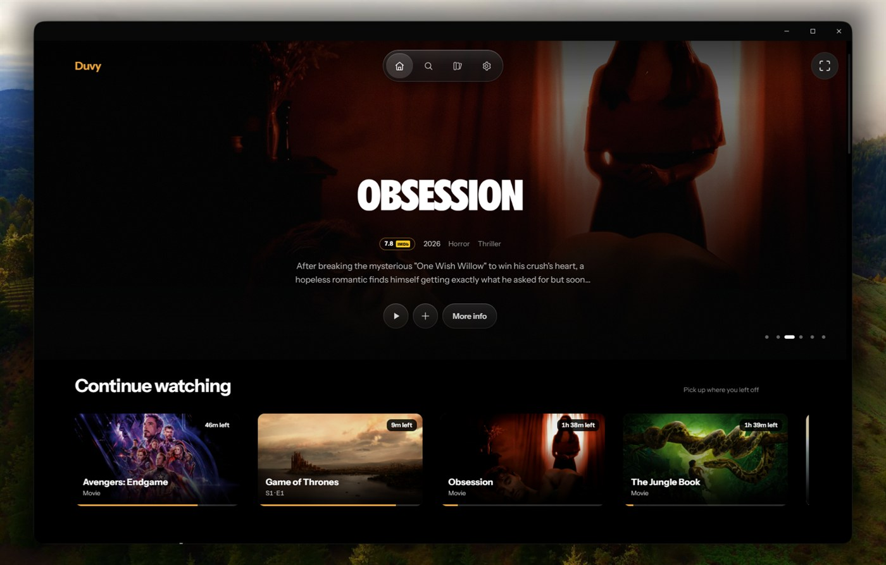

# Duvy

A lightweight desktop media hub for Windows: addons, library and playback in one fast window.

[](https://github.com/SlasshyOverhere/Duvy/actions/workflows/ci.yml)
[](LICENSE)

> **Independent.** Duvy is an independent project. It is not affiliated with Trakt,
> Jellyfin, Emby, any debrid provider, or any addon author. See [NOTICE](NOTICE).



## Why this exists

Most desktop media hubs run the whole app, player included, on one runtime. Duvy keeps the video
path native:

- **Playback is in-process.** libmpv decodes with `hwdec=auto-safe` and paints into the app
  window, with a transparent web layer above it for the controls. There is no player process and
  no video through the WebView, so a large remux cannot stall the interface.
- **Rust owns I/O and parsing.** Streams are ranked in a tested native module, and addon catalogs,
  search, streams and subtitles fan out on parallel Tokio tasks.
- **One local SQLite file in WAL mode** holds addons, library, progress, settings and credentials,
  with the credentials encrypted for the current Windows user. No account is required, and
  nothing leaves the machine unless you opt in to crash reports.

## What it does

- Addon protocol browsing, global search, details with cast and episodes, and a stream picker that
  ranks quality, size, seeders, cache and HDR.
- Library, Continue Watching, Watched, and resume per episode.
- In-app libmpv playback: hardware decoding, cache buffers, audio/subtitle tracks, subtitle styling
  and delay, intro/outro skipping, seek-bar previews, speed and volume.
- Sources: direct HTTP(S), local files, opt-in P2P, four debrid providers, and Jellyfin or Emby.
- Optional TMDB enrichment, Trakt scrobbling and account sync; signed updates.
- Four accent themes, settings with grouped navigation and search.

Status per feature, including what is narrower or not built, is in
[docs/FEATURES.md](docs/FEATURES.md). Planned work is in [docs/ROADMAP.md](docs/ROADMAP.md).

## Requirements

- Windows 10 or 11, x64, with WebView2 (preinstalled on Windows 11)
- [Rust](https://rustup.rs) 1.85 or newer
- [Bun](https://bun.sh) 1.2 or newer

Playback runs on libmpv loaded into the app process. The import library and the runtime DLL live
in `src-tauri/libmpv/`, which is not committed; `bun run app` fetches them once per checkout, or
run the script yourself:

```powershell
powershell -ExecutionPolicy Bypass -File scripts/fetch-libmpv.ps1
```

Installers bundle `libmpv-2.dll` next to the executable, so a released app needs no download and
no separate player install. The bundled build's license is a shipping decision: see
[NOTICE](NOTICE).

## Setup

```bash
bun install
bun run app        # desktop app (Tauri dev)
bun run dev        # Vite only, with an in-browser mock backend
```

The first launch shows onboarding; playback is ready as soon as the app opens. Development builds
use the `app.duvy.desktop.dev` identifier, so their database lives beside, not inside, a
production install.

## Checks

```bash
bun run check      # tsc --noEmit
bun run build      # tsc && vite build
bun run test       # player HUD, regression and crash-report checks
cargo test --manifest-path src-tauri/Cargo.toml
```

CI runs all four on Windows. Interactive playback and third-party services are not covered by
automated tests.

## Bring your own content

Duvy ships no media, no catalogs, no addons and no scrapers. Everything comes from addon URLs you
add, servers you connect, or files you open:

- **Metadata and catalogs:** Cinemeta is installed on first launch; add more from the Addons panel.
- **Streams:** an addon returning HTTP(S) links, magnets or info hashes. Torrent sources stay
  disabled until P2P is allowed in Settings.
- **Optional keys and accounts:** TMDB, a debrid provider, Trakt, or an account for cloud and
  addon-account sync. Each uses that provider's backend and may break without notice.

Addon support follows the documented protocol: `manifest.json`, `/catalog/{type}/{id}`, `/meta`,
`/stream`, `/subtitles`, including `skip`/`search` extras and `tt123:1:2` episode ids.

You are responsible for the addons, servers, accounts and sources you configure, and for
complying with the law and the terms of those services where you live. P2P playback makes your IP
address visible to the swarm. Debrid accounts have their own terms.

## Privacy and local data

- Everything is stored locally in one SQLite file. Release builds send anonymous usage counts to
  PostHog (launches and playbacks: media type, minutes watched, finished or not, plus a random
  install id). Never a title, an account or a link. The switch is in Settings, Privacy, and a
  build without a key counts nothing. Crash reports are opt-in and off by default.
- Credentials are encrypted with Windows DPAPI for the current user before they are written, so a
  copied database cannot be read by another Windows account or machine.
- Network requests go to the addons and services you configure, plus IntroDB for skip markers,
  GitHub for the update feed, PostHog for usage counts and Sentry when crash reports are on. P2P
  traffic goes directly to other peers while a torrent source plays.
- Data lives in `%APPDATA%\app.duvy.desktop`: `duvy.db`, `mpv.log`, `playback.log` and the
  temporary `torrent-cache` folder. Delete the database to reset the app.

What a crash report carries, and how it is scrubbed, is described in
[docs/ARCHITECTURE.md](docs/ARCHITECTURE.md#privacy-and-trust-boundaries).

## Project layout

```
src/            React + TypeScript UI: views, components, typed bridge, store
src-tauri/src/  Rust core: addons, streams, metadata, player, sources, sync, db, commands
scripts/        libmpv fetch and the check suites
docs/           architecture, features, roadmap, releasing
```

The module-by-module breakdown is in [docs/ARCHITECTURE.md](docs/ARCHITECTURE.md).

## Releasing

Releases are built and published by CI only: dispatch the release workflow with a version (or
push a `v*` tag) and it builds, signs and publishes the installers and `latest.json`. Setup and
the signing key are covered in [docs/RELEASING.md](docs/RELEASING.md).

## Contributing

Issues and pull requests are welcome. Read [CONTRIBUTING.md](CONTRIBUTING.md) for the setup,
checks and commit conventions, and [CODE_OF_CONDUCT.md](CODE_OF_CONDUCT.md) for the ground rules.
Security problems go through [SECURITY.md](SECURITY.md), not the public issue tracker.

## License

MIT for this repository's code. Duvy is an independent implementation; no third-party client
code is included here.

Installers bundle a Windows build of libmpv, which also contains FFmpeg, libplacebo and other
libraries, each under its own license. The build fetched by `scripts/fetch-libmpv.ps1` is
GPL-2.0-or-later; shipping it inside a closed-source installer requires either a libmpv built with
`--enable-lgpl` or GPL compliance for the distributed work. See [NOTICE](NOTICE) for the exact
disclosure and licenses.

Metadata is provided by the addons you install and, optionally, TMDB. This product uses the TMDB
API but is not endorsed or certified by TMDB.
