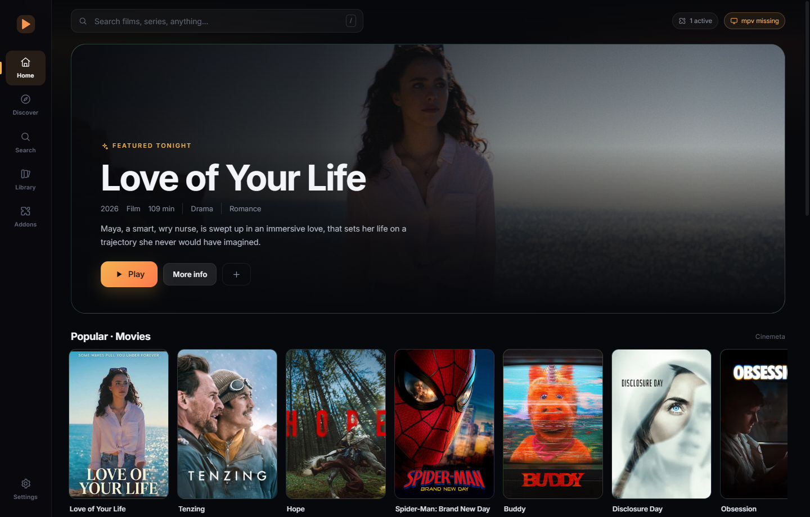

# BetterNuvio

An independent, performance-first desktop media hub for Windows. Rust and Tauri on the inside,
React on the outside, mpv for playback.

[](https://github.com/SlasshyOverhere/BetterNuvio/actions/workflows/ci.yml)
[](LICENSE)

> **Independent.** BetterNuvio is an independent project. It is not affiliated with Trakt,
> Jellyfin, Emby, any debrid provider, or any addon author. See [NOTICE](NOTICE).



## Why this exists

Most desktop media hubs run the whole app, including a large shared UI layer, on one runtime.
BetterNuvio takes a different route: a small Rust core and a WebView that never touches a video
frame:

- **Playback is out of process.** mpv decodes with `hwdec=auto-safe` and paints into the app
  window's client area, with a transparent web layer above it for the controls. The UI drives it
  over mpv's JSON IPC. A large remux cannot stall the interface, and video never travels through
  the WebView.
- **Streams are parsed once, in Rust.** Quality, size, seeders, HDR and cached badges are ranked in
  a native module with unit tests, not per-render string work in JavaScript.
- **Addon fan-out is concurrent.** Catalogs, search, streams and subtitles run as parallel Tokio
  tasks with a shared pooled HTTP client, an 18s timeout and per-host idle limits.
- **One local SQLite file in WAL mode** holds addons, library, progress, watched state, settings
  and integration credentials. Credential values are encrypted with Windows DPAPI for the
  current user. No account is required, and there is no telemetry.

## What works now (0.1.0 beta)

- First-run onboarding: choose a sync account or skip it, while mpv is prepared in the
  background.
- Addon protocol: install from URL, reorder, refresh, open the addon's configure page when it
  advertises one, enable/disable and remove. Cinemeta is installed on first launch.
- Home rows from addon catalogs, an auto-rotating art-led hero, drag-to-scroll rows, poster
  context menus and Continue Watching that updates live.
- Global search across addon search catalogs plus TMDB when a key is set. Addon results stream in
  as each one answers, and the last eight searches are kept as chips.
- Details: artwork and title logos, rating, genres, cast photos, director, trailer link, similar
  titles, seasons and episodes with per-episode progress.
- Search recommendations based on watch history.
- Stream picker: quality, size, seeders, cached marker, languages, HDR/REMUX badges, addon filter,
  copy link and open in browser.
- Sources:
  - direct HTTP(S) streams;
  - local video files;
  - P2P via a local BitTorrent engine, off until you explicitly allow it in Settings;
  - debrid resolution through Real-Debrid, AllDebrid, Premiumize or TorBox keys you provide,
    including the requested file inside a torrent pack;
  - Jellyfin and Emby libraries and direct playback.
- Playback: embedded mpv, hardware decoding toggle, configurable forward and backward cache
  buffers, resume per episode, seeking, speed, volume, audio/subtitle track switching, addon
  subtitles, local subtitle files, subtitle styling (size, bold, colour, outline, background,
  position) and delay, auto-advance, and watched-at-92% bookkeeping.
- Subtitle choices are remembered per episode, and ASS tracks keep their own styling until you
  change a style control.
- Intro and outro skipping from IntroDB community markers, with manual per-show markers that win.
- Library, Continue Watching, Watched, four accent themes, custom title bar.
- Optional TMDB enrichment, Trakt device-code sync and scrobbling, plus optional cloud and
  addon-account sync for library, progress and resume points.
- Settings with grouped navigation and search: player path, cache buffers, language pickers,
  connections and updates.
- Signed, verified updates: the app checks the release feed on launch and every six hours, warns
  with a toast and a desktop notification, and installs from Settings -> Update.

Not built yet: downloads/offline library, local profiles or PIN-protected profile switching
(only cloud-account profile selection exists), a dedicated Discover browser (browse through Home
and Search), app icon packs, translations, update channels, Simkl, MDBList, watch party, JS
plugins, hover previews, subtitle auto-sync, subtitle folder scanning and crash reporting. See
[docs/FEATURES.md](docs/FEATURES.md) for the per-feature status and
[docs/ROADMAP.md](docs/ROADMAP.md) for what is planned.

## Requirements

- Windows 10 or 11, x64, with WebView2 (preinstalled on Windows 11)
- [Rust](https://rustup.rs) 1.85 or newer
- [Bun](https://bun.sh) 1.2 or newer

mpv is not shipped in the installer. On first launch the app downloads a pinned Windows build
into `<app data>/player/`, checking every file against the release's `sha256.txt` before it is
used, so updates never re-download it and the installer stays small. The first run therefore
needs a network connection.

You can skip the download by installing mpv yourself; the app looks at an explicit path from
Settings first, then the downloaded copy, then `PATH`, WinGet, Scoop and the usual Program Files
locations:

```powershell
winget install mpv
```

## Setup

```bash
bun install
bun run app        # desktop app (Tauri dev)
```

The first launch shows onboarding and fetches mpv in the background; playback is ready when the
player status in onboarding turns ready.

For UI work without Rust rebuilds:

```bash
bun run dev        # Vite only, with an in-browser mock backend
```

Development builds use the `app.betternuvio.desktop.dev` identifier, so their database and
downloaded player live beside, not inside, a production install.

## Checks

```bash
bun run check      # tsc --noEmit
bun run build      # tsc && vite build
bun run test       # player HUD regression checks
cargo test --manifest-path src-tauri/Cargo.toml
```

CI runs `check`, `build`, `test` and the Rust tests on Windows. Interactive playback and
third-party services are not covered by automated tests.

## Releasing

Releases are built and published by CI only. Push a tag and `.github/workflows/release.yml` does
the rest: it sets the version from the tag, builds the MSI and NSIS installers, signs the updater
bundles, publishes the GitHub release and uploads `latest.json` (the manifest the in-app updater
reads). The installers do not carry mpv; the app fetches the player on first run from the separate
`player-1` release.

```bash
git tag v1.0.0
git push origin v1.0.0
```

One-time setup: the workflow signs with a minisign key that has to match
`plugins.updater.pubkey` in `src-tauri/tauri.conf.json`. Add the private key as a repository
secret:

```bash
gh secret set TAURI_SIGNING_PRIVATE_KEY < ~/.tauri/betternuvio.key
```

`TAURI_SIGNING_PRIVATE_KEY_PASSWORD` is only needed if the key has a password. Keep the key safe:
lose it and every install already in the wild can no longer verify updates.

The player build is published separately by `.github/workflows/player.yml` (manual dispatch). It
uploads `mpv.exe`, `d3dcompiler_43.dll` and `sha256.txt` to the `player-1` release; first run
verifies every file against that manifest. To ship a new mpv, bump `RELEASE` in
`src-tauri/src/player_setup.rs` and run the workflow again.

A local `bun run tauri build` still works for smoke tests, but it needs the same key
(`TAURI_SIGNING_PRIVATE_KEY_PATH`) and its artifacts are never published.

## Bring your own content

BetterNuvio ships no media, no catalogs, no addons and no scrapers. Everything comes from addon
URLs you add, servers you connect, or files you open.

1. **Metadata and catalogs:** Cinemeta is installed on first launch and gives artwork,
   descriptions and episodes. Add more from the Addons panel.
2. **Streams:** add a stream addon that returns HTTP(S) links, magnets or info hashes. Torrent
   sources stay disabled until P2P is allowed in Settings.
3. **Debrid (optional):** add a Real-Debrid, AllDebrid, Premiumize or TorBox API key. Links are
   unrestricted through your account.
4. **TMDB (optional):** add a free v3 API key for curated rows and richer artwork.
5. **Trakt (optional):** create your own Trakt API application and enter its client id and secret.
6. **Cloud sync (optional, best effort):** sign in with a supported account to sync library,
   progress and watched state. It talks to that provider's backend and may break without notice.
7. **Addon-account sync (optional, best effort):** sign in to pull addons, library and resume
   points from an existing addon client account, and push local changes back. It uses that
   provider's API and may break without notice.

Addon support follows the documented addon protocol: `manifest.json`,
`/catalog/{type}/{id}`, `/meta`, `/stream`, `/subtitles`, including `skip`/`search` extras and
`tt123:1:2` episode ids.

You are responsible for the addons, servers, accounts and sources you configure, and for
complying with the law and the terms of those services where you live. P2P playback makes your IP
address visible to the swarm. Debrid accounts have their own terms.

## Privacy and local data

- Everything is stored locally in one SQLite file. There is no telemetry, analytics or crash
  reporting.
- Credentials (TMDB key, Trakt tokens, debrid keys, Jellyfin/Emby tokens, sync sessions) are kept
  in the local settings table. Each value is encrypted with Windows DPAPI for the current user
  before it is written (existing plaintext rows are upgraded on the next launch), so a copy of
  the database cannot be read by another Windows account or on another machine. The app can still
  read them while you are signed in, so treat the data directory like any other credential store.
- Network requests go to the addons you install, image hosts, the optional services you configure
  (TMDB, Trakt, debrid, Jellyfin/Emby, sync accounts), IntroDB for skip markers, GitHub for the
  first-run player download and the update feed. Addon developers and service operators see
  requests from your IP.
- Skip lookups send only an IMDb id plus season and episode to IntroDB. Addon URLs are validated
  and fetches are bounded, and the WebView runs under a strict Content Security Policy.
- P2P traffic goes directly to other peers while a torrent source is playing.
- Signing out of Trakt or a sync account removes the stored tokens; the cloud integration keeps a
  non-secret account identifier so a later sign-in can tell accounts apart. Deleting the database
  resets everything.

## Where data lives

`%APPDATA%\app.betternuvio.desktop\betternuvio.db` on Windows. The same folder holds `mpv.log`,
`mpv-stderr.log`, the temporary `torrent-cache` directory and `player/` (the mpv the app
downloaded on first run). Seek-bar previews decode into the system temp folder and are removed
when they expire. Delete the database file to reset the app.

Development builds use `%APPDATA%\app.betternuvio.desktop.dev`, so they never touch production
data.

## Project layout

```
src/                     React + TypeScript UI
  components/            shell, title bar, poster rows, stream drawer
  components/player/     player HUD styles and skip helpers
  views/                 Home, Search, Details, Library, Watched, Addons, Onboarding, Player
  views/settings/        media servers, account sync panels, updates
  lib/bridge.ts          typed invoke() wrappers (mock fallback in browser)
  lib/store.tsx          routing, settings, library, progress, playback orchestration
src-tauri/src/
  addons.rs              protocol models, URL builders (+ tests)
  streams.rs             quality/size/seeders parsing and ranking (+ tests)
  meta.rs                Cinemeta-first metadata and cast photos (+ tests)
  tmdb.rs                optional discovery/enrichment (+ tests)
  player.rs              mpv discovery, spawn, JSON IPC, subtitle loading, progress
  player_setup.rs        first-run player download, sha256 verification
  torrent.rs             librqbit session and loopback HTTP stream (+ tests)
  debrid.rs              four debrid providers and link resolution (+ tests)
  trakt.rs               device auth, scrobble and watched sync (+ tests)
  servers.rs             Jellyfin/Emby sign-in, libraries and streams (+ tests)
  skip.rs                IntroDB lookup, manual markers, skip decision (+ tests)
  updates.rs             update checks, background polling, install
  settings.rs            defaults, merge patch, cached load
  secret.rs              DPAPI credential encoding
  frame.rs               seek-bar preview frames
  playback_log.rs        in-memory playback timeline
  db.rs                  SQLite schema and queries (+ tests)
  commands.rs            Tauri command surface
  lib.rs                 state wiring, window helpers, background jobs
scripts/                 player HUD regression checks
docs/                    architecture, features, roadmap
```

Details: [docs/ARCHITECTURE.md](docs/ARCHITECTURE.md).

## Contributing

Issues and pull requests are welcome. Read [CONTRIBUTING.md](CONTRIBUTING.md) for the setup,
checks and commit conventions, and [CODE_OF_CONDUCT.md](CODE_OF_CONDUCT.md) for the ground rules.
Security problems go through [SECURITY.md](SECURITY.md), not the public issue tracker.

## License

MIT for this repository's code. BetterNuvio is an independent implementation; no third-party
client code is included here.

On first run the app downloads a Windows build of mpv, which is free software under
GPL-2.0-or-later, plus Microsoft's `d3dcompiler_43.dll`. The build reports version
`v0.41.0-1227-ge471496c5`; its source is published by the mpv project at
<https://github.com/mpv-player/mpv>. See [NOTICE](NOTICE) for the exact disclosure and licenses.

Metadata is provided by the addons you install and, optionally, TMDB. This product uses the TMDB
API but is not endorsed or certified by TMDB.
